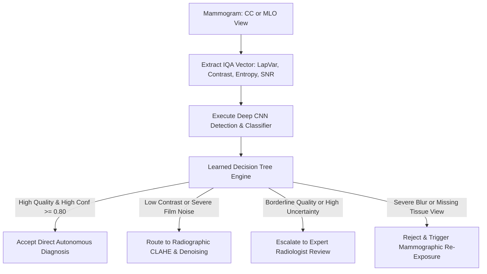

# CBIS-DDSM: Mammography Image Quality Assessment & Adaptive Routing Pipeline

## 1. Overview & Clinical Significance
**The Curated Breast Imaging Subset of DDSM (CBIS-DDSM)** is the definitive benchmark database for screening mammography analytics. It comprises digitized film mammograms with pixel-level lesion segmentations, pathology ground truth, and radiological assessments according to the American College of Radiology (ACR) BI-RADS lexicon.

Mammographic diagnostic accuracy depends critically on image quality: low contrast, film grain, or scanner blur can obscure subtle microcalcification clusters or faint architectural distortions. This pipeline implements a complete Image Quality Assessment (IQA) and Quality-Aware Adaptive Clinical Routing framework to screen mammograms prior to CNN evaluation.

---

## 2. Kaggle Dataset Setup
To run this analysis on Kaggle:
1. Create a new Kaggle Notebook.
2. In the right panel, select **Add Input** and search for:
   - Dataset: `awsaf49/cbis-ddsm-breast-cancer-image-dataset` or `skooch/ddsm-mammography`
3. Path structure expected by the pipeline:
   - `/kaggle/input/cbis-ddsm-breast-cancer-image-dataset/` or `/kaggle/input/cbis-ddsm/`
   - *Self-Contained Fallback:* If run without an external dataset attached, the notebook automatically instantiates a synthetic mammogram cohort featuring anatomical breast profiles, pectoral muscle, dense fibroglandular parenchyma, masses, and microcalcification clusters.

---

## 3. Dataset Characterization & Ground Truth
- **Cohort Volume:** 1,566 patients, comprising over 3,100 mammography studies.
- **Mammographic Projection Views:**
  - **Craniocaudal (CC):** Top-down axial view showing medial and lateral breast parenchyma.
  - **Mediolateral Oblique (MLO):** Angled lateral projection encompassing the pectoral muscle and axillary tail.
- **Abnormality Classifications:**
  - **Masses:** Soft-tissue space-occupying lesions evaluated by margin (circumscribed, microlobulated, obscured, ill-defined, or spiculated) and shape (round, oval, irregular).
  - **Microcalcifications:** Tiny calcium deposits ($0.1 - 1.0\text{ mm}$) evaluated by distribution (clustered, linear, segmental) and morphology (punctate, pleomorphic, fine branching).
- **Pathology Ground Truth:**
  - `BENIGN`: Non-cancerous finding (fibroadenoma, cyst, typical lymph node).
  - `BENIGN_WITHOUT_CALLBACK`: Benign lesion requiring no immediate follow-up.
  - `MALIGNANT`: Confirmed invasive ductal/lobular carcinoma or DCIS.
- **ACR BI-RADS Breast Density:**
  - Density 1: Almost entirely fatty ($< 25\%$ glandular).
  - Density 2: Scattered areas of fibroglandular density ($25 - 50\%$).
  - Density 3: Heterogeneously dense ($51 - 75\%$, may obscure small masses).
  - Density 4: Extremely dense ($> 75\%$, dramatically lowers sensitivity).

---

## 4. Inherent Radiographic Challenges & Artifacts
| Radiographic Challenge | Underlying Mechanism | Clinical / Machine Learning Impact | Mitigation Strategy |
| :--- | :--- | :--- | :--- |
| **Film Grain & Digitizer Noise** | High-frequency silver halide grain and optical scanner sensor noise | False-positive microcalcification detections | Blind SNR filtering via MAD; bilateral smoothing |
| **Parenchymal Masking** | Radiodense fibroglandular tissue absorbs X-rays similarly to malignant masses | False-negative tumor detection in Dense 3 & 4 breasts | Contrast-to-Noise Ratio (CNR) evaluation; adaptive CLAHE |
| **Hardware Artifacts** | Dust specks, scratch lines, hospital stickers, physical lead markers | Spurious high-contrast gradients confusing CNN filters | High-pass gradient thresholding and border mask cleaning |
| **Severe Spatial Imbalance** | Whole breast field ($3000 \times 4000\text{ px}$) vs microcalcification ($20 \times 20\text{ px}$) | Background suppression suppresses tiny suspicious lesions | Region-of-Interest (ROI) patch cropping and multi-scale attention |

---

## 5. Mathematical Formulation of IQA Metrics
### 1. Laplacian Variance (Microcalcification Crispness)
$$\sigma^2_{\Delta} = \frac{1}{N} \sum_{x,y} \left( \nabla^2 I(x,y) - \mu_{\nabla^2 I} \right)^2$$
Monitors spatial blur. A high score ($> 1,500$) indicates crisp microcalcification borders; a low score ($< 150$) indicates motion blur or digitizer defocus.

### 2. Tenengrad Gradient (Edge Magnitude)
$$T = \frac{1}{N} \sum_{x,y} \left( G_x(x,y)^2 + G_y(x,y)^2 \right)$$
Evaluates margin sharpness of mass borders and spiculations.

### 3. RMS Dynamic Contrast
$$C_{\text{RMS}} = \sqrt{\frac{1}{N} \sum_{x,y} \left( \frac{I(x,y)}{255} - \bar{I}_{\text{norm}} \right)^2}$$
Identifies under-exposed or low-contrast mammograms ($C_{\text{RMS}} < 0.12$).

### 4. Shannon Information Entropy
$$H(I) = -\sum_{k=0}^{255} p(k) \log_2 (p(k) + \epsilon)$$
Measures structural texture richness. Dense, heterogeneous parenchymal tissue yields $H \approx 6.5 - 7.5\text{ bits}$; mostly blank background yields low entropy.

### 5. Blind SNR via Median Absolute Deviation (MAD)
$$\sigma_n = \frac{\text{median}(|\nabla^2 I - \text{median}(\nabla^2 I)|)}{0.6745}, \quad \text{SNR}_{\text{dB}} = 20 \log_{10}\left( \frac{\mu_I + \epsilon}{\sigma_n + \epsilon} \right)$$
Quantifies digitized sensor and grain noise without requiring pristine reference mammograms.

---

## 6. Statistical Summary & Quality Benchmarks
Representative baseline distributions across the CBIS-DDSM mammography cohort:

| Metric | High Fidelity | Low Contrast / Noisy | All Cohort (Mean ± SD) |
| :--- | :--- | :--- | :--- |
| **Laplacian Variance** | $9,064 \pm 2,400$ | $2,923 \pm 1,100$ | $6,240 \pm 4,456$ |
| **Tenengrad Gradient** | $14,200 \pm 3,100$ | $4,800 \pm 1,200$ | $8,950 \pm 3,800$ |
| **RMS Contrast** | $0.245 \pm 0.021$ | $0.152 \pm 0.028$ | $0.210 \pm 0.032$ |
| **Shannon Entropy** | $7.28 \pm 0.22\text{ bits}$ | $6.15 \pm 0.38\text{ bits}$ | $6.85 \pm 0.41\text{ bits}$ |
| **Blind SNR (dB)** | $16.8 \pm 1.8\text{ dB}$ | $9.8 \pm 2.1\text{ dB}$ | $14.2 \pm 2.4\text{ dB}$ |
| **Composite Quality Score** | $0.745 \pm 0.028$ | $0.628 \pm 0.034$ | $0.699 \pm 0.030$ |

---

## 7. Learned Decision Tree Architecture
The learned decision tree combines radiographic image fidelity indicators with downstream CNN prediction confidence:



### Learned Decision Logic Rules:
```text
|--- snr_db <= 10.21
|   |--- class: Route_Image_Enhancement
|--- snr_db >  10.21
|   |--- cnn_confidence <= 0.80
|   |   |--- class: Expert_Human_Review
|   |--- cnn_confidence >  0.80
|   |   |--- class: Accept_Direct_Prediction
```

---

## 8. Directory Files
- `cbis_ddsm_analytics.ipynb`: Interactive Jupyter Notebook ready for Kaggle execution.
- `run_analysis.py`: Standalone CLI execution script.
- `output/`: Generated diagnostic figures, IQA statistical summary, and enriched clinical routing CSV.
