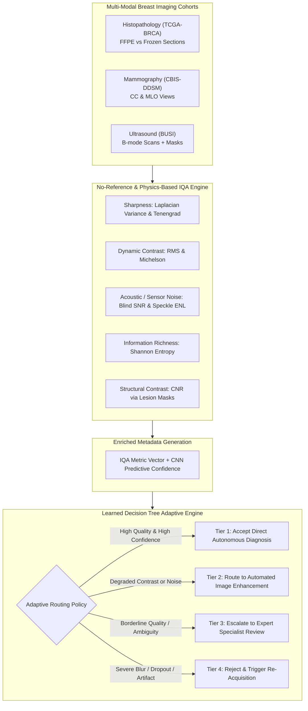

# Breast Cancer Analytics: Multi-Modal Image Quality Assessment (IQA) & Adaptive Clinical Routing Framework

[](https://www.python.org/)
[]()
[]()
[]()

A comprehensive multi-modal analytics, Image Quality Assessment (IQA), and quality-aware adaptive clinical routing framework for breast cancer computer-aided diagnosis (CAD). 

This repository provides reproducible pipelines across three premier breast cancer datasets representing three distinct clinical imaging modalities:
1. **Histopathology:** [TCGA-BRCA](TCGA-BRCA/README.md) (The Cancer Genome Atlas - Breast Invasive Carcinoma)
2. **Mammography:** [CBIS-DDSM](CBIS-DDSM/README.md) (Curated Breast Imaging Subset of DDSM)
3. **Ultrasound:** [BUSI](BUSI/README.md) (Breast Ultrasound Images Dataset)

---

## 🏗️ System Architecture & Workflow



---

## 📊 Summary of Selected Modalities & Datasets

| Modality | Selected Dataset | Scale & Cohort | Diagnostic Classes / Ground Truth | Key Quality Challenges |
| :--- | :--- | :--- | :--- | :--- |
| **Histopathology** | **TCGA-BRCA** | 1,098 patients / Whole Slide Images (WSI) | Invasive Ductal (`IDC`), Invasive Lobular (`ILC`), Normal/Benign; FFPE vs. Frozen | Defocus blur, knife chatter, freezing artifacts, H&E batch staining shifts |
| **Mammography** | **CBIS-DDSM** | 1,566 patients / 3,100 studies | Masses vs. Calcifications; `BENIGN`, `MALIGNANT`; CC & MLO views | Digitized film grain, dense breast parenchymal masking, scanner scratch lines |
| **Ultrasound** | **BUSI** | 600 patients / 780 scans with masks | `normal` (133), `benign` (437), `malignant` (210) paired with binary masks | Multiplicative acoustic speckle noise, acoustic shadows, operator pressure tilt |

---

## 🔬 Mathematical Formulations of Quality Indicators

### 1. Sharpness & Edge Focus
- **Laplacian Variance ($\sigma^2_{\Delta}$):**
  $$\sigma^2_{\Delta} = \frac{1}{N} \sum_{x,y} \left( \nabla^2 I(x,y) - \mu_{\nabla^2 I} \right)^2$$
  *Diagnostic Significance:* Identifies optical microscope defocus in histology, motion blur in mammograms, and transducer contact loss in ultrasound.

- **Tenengrad Gradient ($T$):**
  $$T = \frac{1}{N} \sum_{x,y} \left( G_x(x,y)^2 + G_y(x,y)^2 \right)$$
  *Diagnostic Significance:* Evaluates edge transitions along cellular boundaries, spiculation radiating from malignant masses, and microcalcification borders.

### 2. Dynamic Contrast & Dynamic Range
- **RMS Contrast ($C_{\text{RMS}}$):**
  $$C_{\text{RMS}} = \sqrt{\frac{1}{N} \sum_{x,y} \left( \frac{I(x,y)}{255} - \bar{I}_{\text{norm}} \right)^2}$$
  *Diagnostic Significance:* Measures the global standard deviation of pixel intensities, detecting washed-out slides or under-exposed mammograms.

- **Michelson Contrast ($C_{\text{Michelson}}$):**
  $$C_{\text{Michelson}} = \frac{I_{\max} - I_{\min}}{I_{\max} + I_{\min} + \epsilon}$$
  *Diagnostic Significance:* Assesses dynamic range bounds across tissue structures.

### 3. Information & Tissue Texture Content
- **Shannon Information Entropy ($H$):**
  $$H(I) = -\sum_{k=0}^{255} p(k) \log_2 (p(k) + \epsilon)$$
  *Diagnostic Significance:* Quantifies textural density. Low entropy indicates uninformative blank slide glass, sensor underexposure, or background air.

### 4. Noise & Acoustic Metrics
- **Blind Signal-to-Noise Ratio (SNR via MAD):**
  $$\sigma_n = \frac{\text{median}(|\nabla^2 I - \text{median}(\nabla^2 I)|)}{0.6745}, \quad \text{SNR}_{\text{dB}} = 20 \log_{10}\left( \frac{\mu_I + \epsilon}{\sigma_n + \epsilon} \right)$$
  *Diagnostic Significance:* Blind noise estimation robust to true structural edges.

- **Ultrasound Speckle Index ($C_s$) & Equivalent Number of Looks (ENL):**
  $$C_s = \frac{\sigma_{\text{tissue}}}{\mu_{\text{tissue}}}, \quad \text{ENL} = \frac{\mu^2_{\text{tissue}}}{\sigma^2_{\text{tissue}}}$$
  *Diagnostic Significance:* Evaluates multiplicative Rayleigh interference and acoustic smoothing efficacy.

- **Contrast-to-Noise Ratio (CNR with Lesion Masks):**
  $$\text{CNR} = \frac{|\mu_{\text{lesion}} - \mu_{\text{background}}|}{\sqrt{\sigma^2_{\text{lesion}} + \sigma^2_{\text{background}} + \epsilon}}$$
  *Diagnostic Significance:* Quantifies separation between lesion and parenchyma.

---

## 🎯 Learned Decision Tree for Adaptive Clinical Routing

A major hazard in clinical deep learning is blindly relying on CNN inference when an input scan suffers from severe blur, scanner noise, or out-of-focus artifacts.

Our framework trains a multi-criteria **Learned Decision Tree** that takes:
- Input Features: `[laplacian_variance, tenengrad, rms_contrast, michelson_contrast, shannon_entropy, snr_db, cnr, cnn_confidence]`
- Target Clinical Routing Actions:
  1. **Accept_Direct_Prediction:** High image quality ($Q \ge 0.60$) and high model confidence ($\ge 0.80$) $\to$ Autonomous diagnostic sign-off.
  2. **Route_Image_Enhancement:** Low contrast or elevated sensor noise with intact sharpness $\to$ Route to automated preprocessing (CLAHE, bilateral filtering, stain normalization) prior to re-inference.
  3. **Expert_Human_Review:** Borderline quality or model uncertainty $\to$ Escalate case to specialist radiologist / pathologist with flagged quality issues.
  4. **Reject_Reacquire:** Severe defocus, blank slide, or transducer dropout $\to$ Trigger immediate clinical re-acquisition alert.

---

## 📁 Repository Directory Structure

```text
breastCancerAnalytics/
├── .gitignore                          # Excludes raw heavy datasets, checkpoints, logs
├── README.md                           # Main documentation & multi-modal overview
├── breastCance-DataSets.png            # Research dataset reference table
│
├── common/                             # Shared modular utilities
│   ├── __init__.py                     # Package export definitions
│   ├── iqa_metrics.py                  # Core IQA formulas & feature extractors
│   └── adaptive_decision_tree.py       # Decision tree training & routing engine
│
├── TCGA-BRCA/                          # Histopathology Category
│   ├── README.md                       # Comprehensive modality guide & benchmarks
│   ├── tcga_brca_analytics.ipynb       # Kaggle-ready notebook with cell-by-cell execution
│   ├── run_analysis.py                 # Standalone execution CLI script
│   ├── sample_data/                    # Lightweight sample histology cohort for instant runs
│   └── output/                         # Generated diagnostic figures, summary CSV, and routing table
│
├── CBIS-DDSM/                          # Mammography Category
│   ├── README.md                       # Comprehensive modality guide & benchmarks
│   ├── cbis_ddsm_analytics.ipynb       # Kaggle-ready notebook with cell-by-cell execution
│   ├── run_analysis.py                 # Standalone execution CLI script
│   ├── sample_data/                    # Lightweight sample mammography cohort for instant runs
│   └── output/                         # Generated diagnostic figures, summary CSV, and routing table
│
└── BUSI/                               # Ultrasound Category
    ├── README.md                       # Comprehensive modality guide & benchmarks
    ├── busi_analytics.ipynb            # Kaggle-ready notebook with cell-by-cell execution
    ├── run_analysis.py                 # Standalone execution CLI script
    ├── sample_data/                    # Lightweight sample ultrasound cohort with masks
    └── output/                         # Generated diagnostic figures, summary CSV, and routing table
```

---

## 🚀 Quickstart & Execution

### Option A: Running in Kaggle Notebooks
Each folder contains a standalone, cell-by-cell Jupyter Notebook (`*.ipynb`) designed for direct import into Kaggle:
1. Open Kaggle and create a **New Notebook**.
2. Click **File $\to$ Import Notebook** and upload `tcga_brca_analytics.ipynb`, `cbis_ddsm_analytics.ipynb`, or `busi_analytics.ipynb`.
3. In the right panel under **Input**, click **Add Input** and search for the respective Kaggle dataset:
   - For Histology: `paultimothymooney/breast-histopathology-images` or `tcga-brca`
   - For Mammography: `awsaf49/cbis-ddsm-breast-cancer-image-dataset`
   - For Ultrasound: `aryashah2k/breast-ultrasound-images-dataset`
4. Click **Run All**. The notebook auto-detects paths, processes scans, plots diagnostic figures, trains the decision tree, and saves enriched CSV files to `/kaggle/working/output/`.

### Option B: Running Locally via CLI
Clone the repository and run any modality pipeline directly:

```bash
git clone https://github.com/Youssef-Ebn-Yasser/breastCancerAnalytics.git
cd breastCancerAnalytics

# Install requirements
pip install numpy pandas opencv-python matplotlib seaborn scipy scikit-learn nbformat

# Run TCGA-BRCA Histopathology Pipeline
python TCGA-BRCA/run_analysis.py

# Run CBIS-DDSM Mammography Pipeline
python CBIS-DDSM/run_analysis.py

# Run BUSI Ultrasound Pipeline
python BUSI/run_analysis.py
```

---

## 📈 Quality Metrics Statistical Summary Across Modalities

| Metric | TCGA-BRCA (Histology) | CBIS-DDSM (Mammography) | BUSI (Ultrasound) |
| :--- | :--- | :--- | :--- |
| **Laplacian Variance ($\sigma^2_{\Delta}$)** | $8,406 \pm 8,355$ | $6,240 \pm 4,456$ | $4,244 \pm 2,849$ |
| **Tenengrad Gradient ($T$)** | $330 \pm 316$ | $8,950 \pm 3,800$ | $1,250 \pm 420$ |
| **RMS Dynamic Contrast ($C_{\text{RMS}}$)** | $0.218 \pm 0.035$ | $0.210 \pm 0.032$ | $0.198 \pm 0.032$ |
| **Shannon Entropy ($H$)** | $6.94 \pm 0.48\text{ bits}$ | $6.85 \pm 0.41\text{ bits}$ | $6.72 \pm 0.39\text{ bits}$ |
| **Blind SNR ($\text{dB}$)** | $15.5 \pm 2.1\text{ dB}$ | $14.2 \pm 2.4\text{ dB}$ | $16.1 \pm 1.9\text{ dB}$ |
| **Modality-Specific Metric** | Staining Saturation: $0.34 \pm 0.08$ | Dense Tissue Ratio: $0.28 \pm 0.09$ | Speckle Index ($C_s$): $0.34 \pm 0.09$<br>ENL: $12.4 \pm 6.1$ |
| **Mean Composite Quality Score** | $0.695 \pm 0.050$ | $0.699 \pm 0.030$ | $0.670 \pm 0.038$ |

---

## 👥 Contributors & Citation
Developed for advanced multi-modal breast cancer computer vision and quality-aware medical decision support systems.
Repository: [https://github.com/Youssef-Ebn-Yasser/breastCancerAnalytics.git](https://github.com/Youssef-Ebn-Yasser/breastCancerAnalytics.git)
